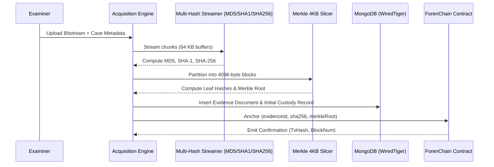

# ForenSight — Forensic Methodology & Evidentiary Standards

**Target Audience:** Academic Faculty Evaluator (Digital Forensics / Cyber Crime Investigation / Information Security)  
**System:** ForenSight — Digital Forensics Investigation & Evidence Management Platform  
**Compliance Standards:** ISO/IEC 27037:2012 (Digital Evidence Handling), RFC 3227 (Order of Volatility), NIST SP 800-86, Bharatiya Sakshya Adhiniyam, 2023 (Section 63(4))

---

## 1. Evidentiary Principles & Forensic Readiness

ForenSight enforces the core tenets of forensic admissibility defined in **ISO/IEC 27037:2012**:
1. **Invariance (Integrity):** The acquired digital artifact must remain completely unchanged from the point of seizure through trial production.
2. **Auditability (Traceability):** Every action performed on an evidence item, including read operations, analyses, transfers, and verifications, must be logged immutably.
3. **Repeatability (Verifiability):** An independent examiner using standard cryptographic tools (e.g. `sha256sum`, `md5sum`) must arrive at identical mathematical digests given the original bitstream.

---

## 2. Evidence Acquisition & Multi-Hashing Pipeline

When digital evidence is registered through the ForenSight Acquisition Intake (`/register`):



### Stream-Buffered Multi-Hashing Architecture
Traditional forensic tools often load files into system RAM to compute hashes, creating out-of-memory (OOM) vulnerabilities on multi-gigabyte forensic images. ForenSight executes **single-pass streaming hashing**:
```python
# app/services/acquisition.py
CHUNK_SIZE = 65536  # 64 KB streaming buffer
hasher_md5 = hashlib.md5()
hasher_sha1 = hashlib.sha1()
hasher_sha256 = hashlib.sha256()

with open(file_path, "rb") as f:
    while chunk := f.read(CHUNK_SIZE):
        hasher_md5.update(chunk)
        hasher_sha1.update(chunk)
        hasher_sha256.update(chunk)
```
- **Time Complexity:** $O(N)$ where $N$ is file size.
- **Memory Complexity:** $O(1)$ constant memory overhead (64 KB RAM maximum).

---

## 3. Merkle Tree Block Hashing & Tamper Localization

While a full-file SHA-256 hash confirms whether a file was modified, it cannot identify **where** the alteration occurred. ForenSight implements deterministic **4096-Byte Merkle Tree Slicing**:

1. **Block Partitioning:** The bitstream is sliced into sequential 4096-byte blocks: $B_0, B_1, \dots, B_{k-1}$.
2. **Leaf Hash Generation:** For every block $i$:
   $$H_i = \text{SHA-256}(B_i)$$
3. **Tree Reduction:** Adjacent leaf hashes are recursively concatenated and hashed pairwise until the single 32-byte **Merkle Root** is produced:
   $$\text{Parent} = \text{SHA-256}(H_{2j} \parallel H_{2j+1})$$

```
                  [ Merkle Root ]
                     /        \
             [ H_01 ]          [ H_23 ]
             /      \          /      \
          [ H_0 ]   [ H_1 ]  [ H_2 ]  [ H_3 ]
          (Block0)  (Block1) (Block2) (Block3)
```

### Byte-Level Tamper Localization Algorithm
When verifying a candidate evidence copy against the original manifest (`/verify`):
1. The candidate copy is partitioned into identical 4096-byte blocks.
2. ForenSight compares candidate block hashes against the baseline manifest block by block:
   $$\text{DiffBlocks} = \{ i \mid H_{\text{candidate}, i} \neq H_{\text{baseline}, i} \}$$
3. Each differing block index $i$ corresponds to the exact physical byte range:
   $$\text{Byte Range} = [i \times 4096, \; (i + 1) \times 4096 - 1]$$
4. The system outputs an interactive **Tamper Localization Heatmap** highlighting modified sectors.

---

## 4. The 5-Part Forensic Diagnostic Engine

ForenSight features an autonomous, multi-disciplinary diagnostic suite:

### Check 1: Cryptographic Multi-Hashing & Algorithm Divergence
Computes MD5, SHA-1, and SHA-256 simultaneously. Protects against theoretical MD5/SHA-1 collision attacks by requiring all three digests to match baseline records.

### Check 2: Binary File Identity & Magic Byte Verification
Cybercriminals frequently disguise executable malware by modifying file extensions (e.g. renaming `trojan.exe` to `invoice.pdf`). ForenSight inspects raw leading header bytes:
- **JPEG:** `FF D8 FF`
- **PNG:** `89 50 4E 47 0D 0A 1A 0A`
- **PDF:** `25 50 44 46` (`%PDF`)
- **ZIP / Office OpenXML:** `50 4B 03 04` (`PK..`)
- **Windows PE Executable:** `4D 5A` (`MZ`)

If the declared file extension conflicts with the detected magic byte signature, ForenSight raises a **CRITICAL Severity Diagnostic Finding** (`MAGIC_BYTES_MISMATCH`).

### Check 3: EXIF, GPS & Office Metadata Extraction
Extracts embedded camera metadata, lens details, GPS decimal coordinates, device serial numbers, and software editing footprints (e.g. "Adobe Photoshop 2024") using `Pillow` and `pypdf`.

### Check 4: Error Level Analysis (ELA) & Image Manipulation Heatmaps
JPEG compression functions by dividing images into $8 \times 8$ pixel grids and applying discrete cosine transforms (DCT). When an image is spliced or cloned, the manipulated region exhibits a different error rate compared to the surrounding pixels:
1. Re-compresses the candidate image at a fixed quality scale (default 95%).
2. Computes the absolute pixel difference between original and recompressed bitmaps:
   $$\Delta(x, y) = |I_{\text{orig}}(x, y) - I_{\text{recomp}}(x, y)|$$
3. Amplifies the delta matrix by an ELA scale factor ($15\times$) to visualize high-frequency edge anomalies.
4. Generates an OpenCV false-color heatmap overlay (`cv2.applyColorMap(..., cv2.COLORMAP_JET)`).

### Check 5: Temporal Inversion & Anachronism Detection
Analyzes filesystem metadata and internal document timestamps to identify temporal paradoxes:
- **Inverted Modification:** File `Last Modified` timestamp precedes `Creation` timestamp.
- **Future Anachronism:** Timestamps situated in the future relative to system clock at acquisition.
- **Exif vs. Filesystem Mismatch:** EXIF capture timestamp deviates significantly from filesystem creation timestamp.

---

## 5. Append-Only Cryptographic Chain of Custody

Chain of custody is the legal backbone of digital evidence admissibility. ForenSight implements an append-only digital custody ledger utilizing **SHA-256 Hash Chaining**:

For custody event $E_k$:
$$\text{Payload}_k = \text{CanonicalJSON}(E_k.\text{evidenceId}, E_k.\text{action}, E_k.\text{fromCustodian}, E_k.\text{toCustodian}, E_k.\text{timestamp}, E_k.\text{location}, E_k.\text{reason})$$
$$\text{EventHash}_k = \text{SHA-256}(\text{EventHash}_{k-1} \parallel \text{Payload}_k)$$

Where $\text{EventHash}_0 = \text{SHA-256}("00000000000000000000000000000000")$ (Genesis Hash).

### Verification Guarantee
If any historical record is deleted, altered, or reordered in the database, recomputing the hash sequence fails at index $k$:
$$\text{RecomputedHash}_k \neq \text{StoredEventHash}_k$$
The platform immediately flags **Custody Chain Compromised** and highlights the exact broken link.

---

## 6. Continuous Integrity Watchdog Daemon

To guard against silent data corruption, bit rot, or unauthorized out-of-band disk tampering, ForenSight runs an autonomous background watchdog daemon (`app/services/watchdog.py`):
1. **Periodic Execution:** Audits repository files every 30 seconds.
2. **Byte-Level Verification:** Reads files from `storage/evidence/` and recalculates SHA-256 hashes.
3. **Double Verification:** Cross-checks recalculated hashes against both MongoDB baseline records and smart contract anchor digests.
4. **Real-Time Notification:** If any byte deviates, the watchdog instantly updates `integrityStatus = 'COMPROMISED'`, logs a critical audit finding, and streams real-time Server-Sent Events (SSE) to all connected examiner dashboards.

---

## 7. Legal Admissibility Under Section 63(4) of the BSA, 2023

In modern legal jurisdictions, digital evidence must be accompanied by a statutory certificate of authenticity:
- **India:** Section 63(4) of the **Bharatiya Sakshya Adhiniyam, 2023 (BSA)** (superseding Section 65B of the Indian Evidence Act, 1872).
- **United States:** Federal Rules of Evidence (FRE) Rule 902(13) & (14) (Certified Records Generated by Electronic Process).

ForenSight automatically compiles court-admissible PDF certificates with statutory declarations:
1. Certifies that the computer system and storage repository operated normally without unauthorized interference.
2. Affixes cryptographic SHA-256 hashes, Merkle root digests, and acquisition timestamps.
3. Includes examiner identity, qualifications, and tamper audit logs.
